# SafeGuard

SafeGuard is a real-time workplace safety monitor. It uses a custom-trained YOLOv8 model to detect personal protective equipment (PPE) and other objects in a webcam feed. The dashboard shows the annotated video and raises an alert when the model detects someone without a helmet.

## Model outputs

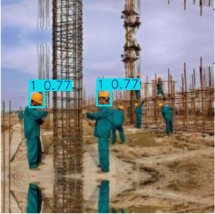

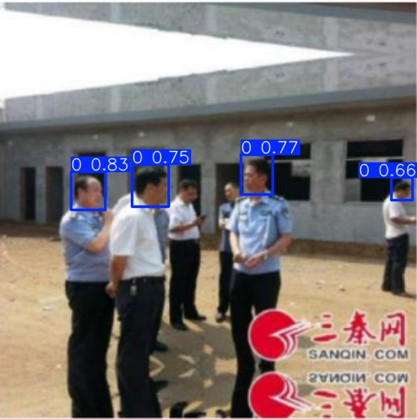

The model stores these two labels as numbers. The live dashboard maps class 1 to helmet and class 0 to no_helmet.

These examples were generated with the project's trained weights (`best.pt`) on sample images from the project report, using the same 0.60 confidence threshold as the live application.

## How it works

1. OpenCV reads frames from the default webcam.
2. Ultralytics YOLOv8 runs inference with `best.pt`. The Python backend draws bounding boxes, class labels, and confidence scores.
3. The backend sends the annotated JPEG and detection data to the browser over a local WebSocket.
4. The dashboard shows the live feed, detections, FPS, and an alert log. A `no_helmet` detection triggers a visual and audio alert. With valid bot credentials, the backend also attempts to send a warning and a snapshot through Telegram.

The live application displays six classes: `no_helmet`, `helmet`, `gloves`, `forklift`, `head`, and `person`. The alert logic is based on `no_helmet`.

## Dataset and training

The team prepared a custom PPE dataset using Roboflow and trained Ultralytics YOLOv8n for 40 epochs at an input size of 640 × 640. The live app loads the exported checkpoint, `best.pt`.

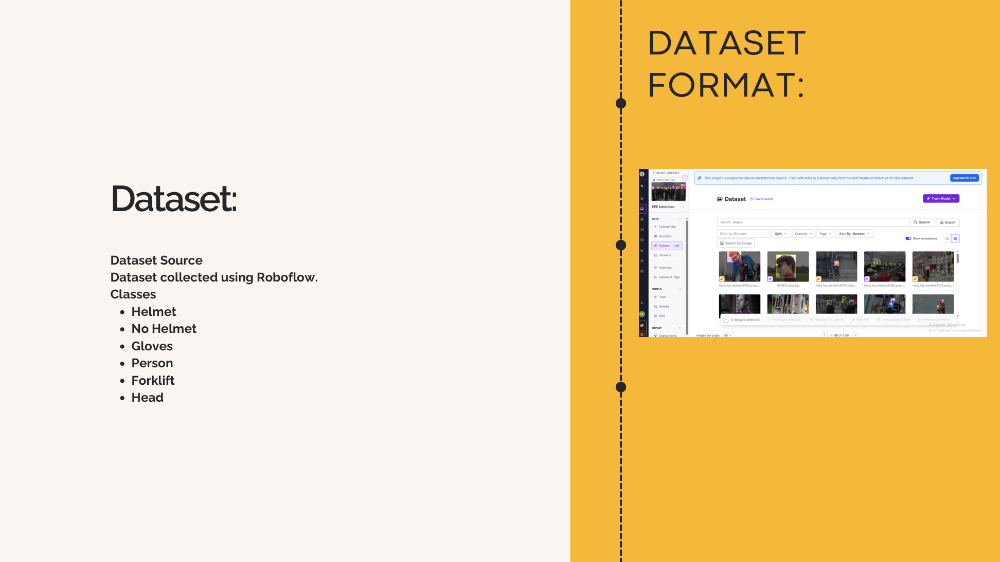

### Training results

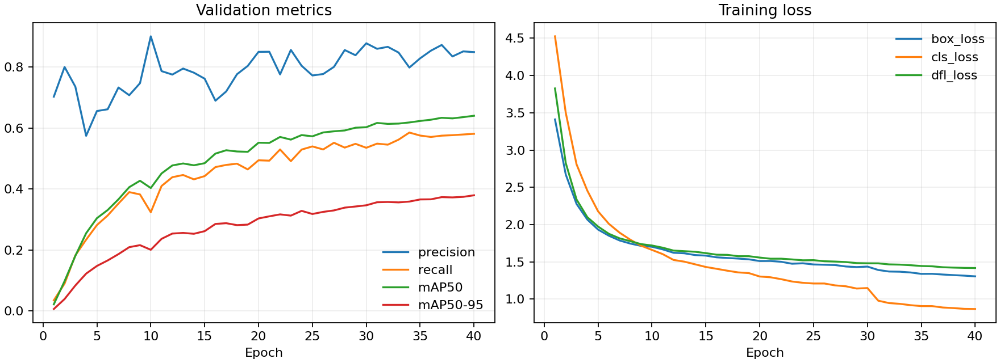

The chart was recreated from the per-epoch history embedded in `best.pt`. The checkpoint also records these aggregate box-detection metrics:

| Precision | Recall | mAP@0.50 | mAP@0.50–0.95 |
| ---: | ---: | ---: | ---: |
| 84.87% | 58.07% | 64.00% | 37.91% |

## Image-processing gallery

The gallery includes all nine image panels available in the project report. They document preprocessing and augmentation experiments. The complete train/validation/test image folders and original YOLO batch plots were unavailable in the local project files.

### Grayscale conversion

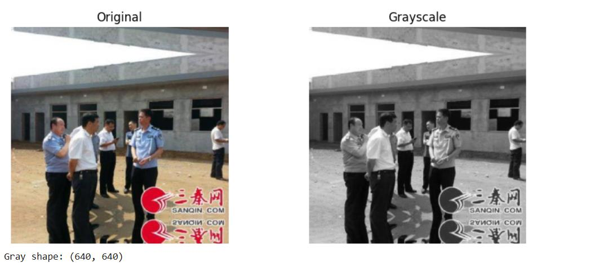

### Resizing from 640 × 640 to 320 × 320

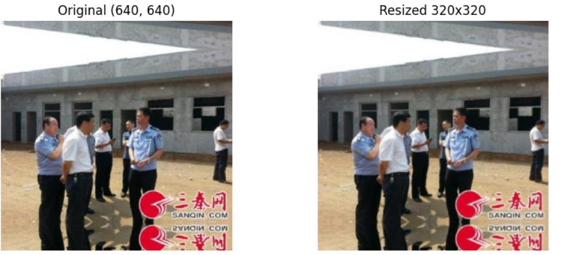

### Pixel normalization

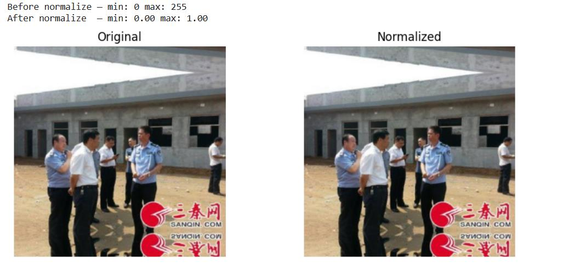

### Horizontal and vertical flips

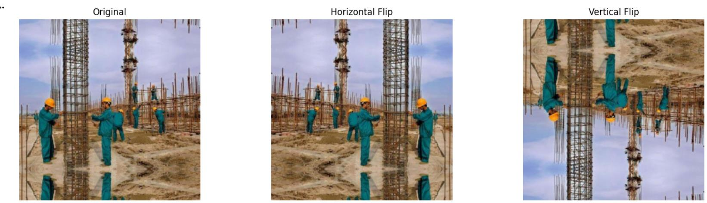

### 90° and 180° rotations

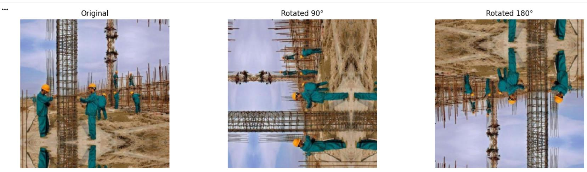

### Brightness adjustments

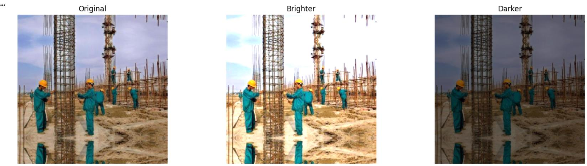

### Gaussian, salt-and-pepper, and speckle noise

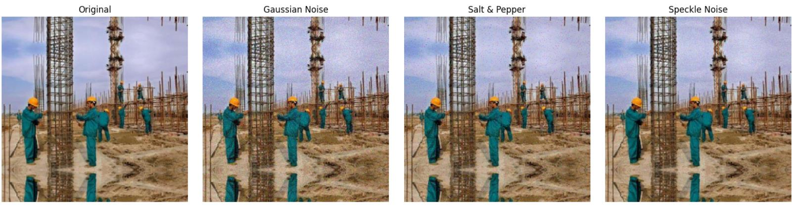

### Gaussian blur

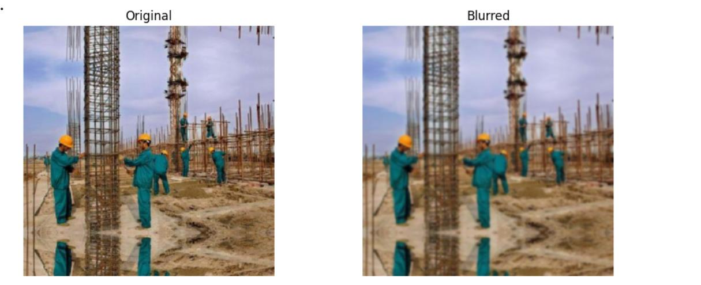

### Sobel edge detection

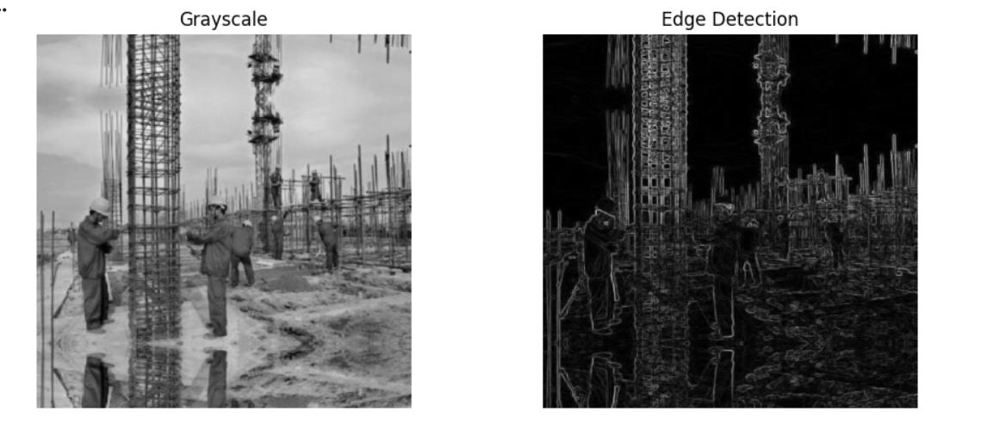

## Run locally on Windows

You need Python, a webcam, and a browser. Open PowerShell in the project folder, then run:

~~~powershell
python -m pip install ultralytics opencv-python websockets requests
python live.py
~~~

Keep the terminal open. Open `index.html` in a browser on the same computer, then click **Connect to Camera**. The dashboard connects to `ws://localhost:8765`.

Before testing helmet violations or sharing the project, revoke any Telegram bot token stored in `live.py` and move the replacement credentials outside the source code. Use a test chat if you want to verify snapshot delivery.

## Project files

| File | Purpose |
| --- | --- |
| `live.py` | Camera capture, inference, WebSocket server, and Telegram alerts |
| `index.html` | Browser dashboard and audio alerts |
| `best.pt` | Trained YOLOv8 weights |

The dashboard reports what the model detects. An **ALL CLEAR** message means the current frame has no qualifying `no_helmet` detection. Missed detections are possible.
